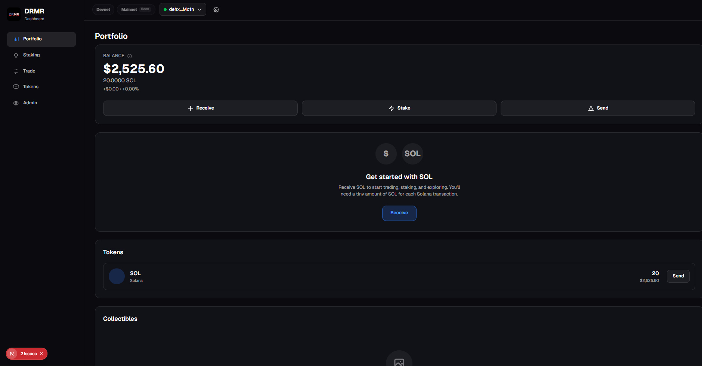
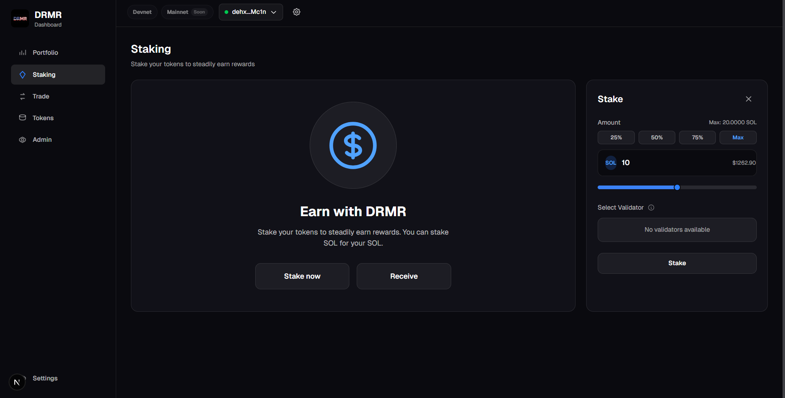
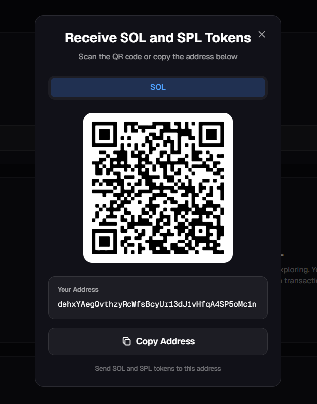
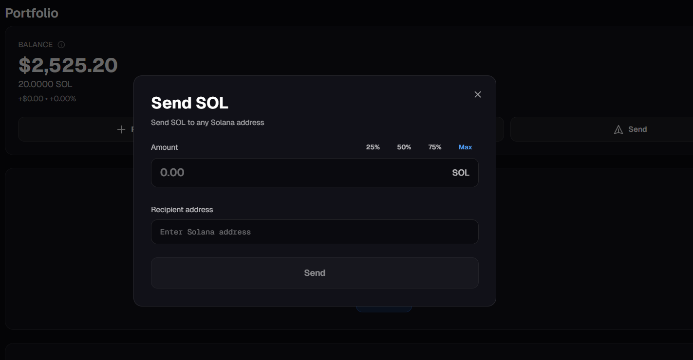

# DRMR Dashboard - Development Report

## Project Overview
DRMR Dashboard is a comprehensive Solana wallet dashboard application built with Next.js, featuring portfolio management, staking capabilities, and NFT display. The application is optimized for both desktop and mobile devices with a modern dark theme.

---

## Development Timeline

### Phase 1: UI Overhaul & Theme Implementation
**Status: ✅ Completed**

#### Design System
- **Color Scheme**: Dark base theme with red and blue accents
- **Base Colors**: 
  - Primary Background: `#0a0a0f`
  - Secondary Background: `#111118`
  - Card Background: `#111118`
- **Accent Colors**:
  - Blue: `#3b82f6` (Primary accent)
  - Red: `#ef4444` (Secondary accent)
- **Removed**: All yellow accents, gradients, and blur effects for uniform design

#### UI Components Standardized
- **Buttons**: `rounded-xl border border-white/10 bg-white/5 hover:bg-white/10`
- **Cards**: `rounded-xl border border-white/10 bg-[#111118]`
- **Inputs**: `rounded-xl border border-white/10 bg-[#0a0a0f]`
- **No gradients, blur effects, or shadows** for consistent flat design

---

### Phase 2: Mobile Responsiveness
**Status: ✅ Completed**

#### Responsive Features Implemented
- **Sidebar Navigation**: Collapsible mobile menu with hamburger icon
- **Dashboard Layout**: Adaptive grid layouts for all screen sizes
- **Portfolio Page**: Responsive token cards and NFT grid
- **Staking Page**: Mobile-optimized modal and validator selection
- **Admin Page**: Horizontal scroll for tables on mobile
- **Trade Page**: Responsive swap interface

#### Breakpoints Used
- Mobile: `< 640px`
- Tablet: `640px - 1024px`
- Desktop: `> 1024px`

---

### Phase 3: Core Features

#### Portfolio Management
**Status: ✅ Completed**

**Features:**
- Real-time SOL balance display
- SPL token list with logos
- NFT collectibles gallery
- Activity history
- USD value conversion

**Removed Sections:**
- Buy button
- Token Balance History chart
- Swap section

**New Features:**
- SOL amount displayed in balance card
- Empty state for NFTs with helpful message
- Skeleton loading states for all data

**Image Placeholder:**
[Portfolio Page Screenshot - Balance Card, Token List, NFT Grid]

---

#### Staking Functionality
**Status: ✅ Completed**

**Features Implemented:**
- **Devnet Validator Integration**: 
  - Fetches real devnet validators from Solana network
  - Calculates and displays APY for each validator
  - Syncs validator data with PostgreSQL database

- **Staking Workflow**:
  - Create stake account on Solana
  - Delegate stake to selected validator
  - Track staking records in database
  - Verify stake account balance

- **Enhanced Staking Modal**:
  - Amount slider with visual progress bar
  - Percentage buttons (25%, 50%, 75%, Max)
  - USD conversion display
  - Validator card selection (replaced dropdown)
  - Validator details: Name, APY, Commission, Total Stake
  - Selected validator highlighting

**Image Placeholder:**
[Staking Page Screenshot - Main Interface]

**Image Placeholder:**
[Staking Modal Screenshot - Slider and Validator Selection]

---

#### Token Logo Management
**Status: ✅ Completed**

**Implementation:**
- **Server-side API Route**: `/api/token-logo` using Metaplex
- **Client-side Caching**: IndexedDB for persistent storage
- **Fallback Strategy**: Metaplex → Jupiter API → Placeholder
- **Cache Management**: Automatic cleanup of expired entries
- **Loading States**: Skeleton placeholders during logo fetch

**Image Placeholder:**
[Token List with Logos Screenshot]

---

#### Modals & User Interactions
**Status: ✅ Completed**

**Receive Modal:**
- QR code generation for wallet address
- Address copy functionality
- Token selector (SOL/SPL tokens)
- Footer message: "Send SOL and SPL tokens to this address"

**Image Placeholder:**
[Receive Modal Screenshot - QR Code Display]

**Send Modal:**
- Amount input with percentage buttons
- Recipient address input
- USD conversion display
- Maximized sizing for better UX
- Loading and error states

**Image Placeholder:**
[Send Modal Screenshot]

---

### Phase 4: Loading States & UX Improvements
**Status: ✅ Completed**

#### Skeleton Components Created
- `BalanceSkeleton`: Balance card loading state
- `TokenRowSkeleton`: Individual token row loading
- `TokenListSkeleton`: Token list loading
- `NftCardSkeleton`: NFT card loading
- `NftGridSkeleton`: NFT grid loading
- `ActivityItemSkeleton`: Activity item loading
- `ActivityListSkeleton`: Activity list loading
- `WalletBalanceSkeleton`: Wallet balance loading
- `LogoImageSkeleton`: Token logo loading
- `ChartSkeleton`: Chart loading state

#### Dashboard Loader
- Full-screen loading overlay
- DRMR logo display
- Spinning loaders with blue/red accents
- Progress bar animation
- Minimum display time for smooth UX
- Fade-out animation

**Image Placeholder:**
[Dashboard Loader Screenshot]

---

### Phase 5: Network Configuration
**Status: ✅ Completed**

#### Environment Variables
- `NEXT_PUBLIC_SOLANA_RPC_MAINNET`: Mainnet RPC endpoint
- `NEXT_PUBLIC_SOLANA_RPC_DEVNET`: Devnet RPC endpoint
- `NEXT_PUBLIC_MODE`: Current network mode (devnet/mainnet)

#### Network Toggle Component
- Devnet active by default
- Mainnet marked as "Coming Soon"
- Visual indicators for active network
- Consistent network state across app

**Image Placeholder:**
[Network Toggle Component Screenshot]

---

### Phase 6: Error Handling & Debugging
**Status: ✅ Completed**

#### Debug Logging Added
- Balance retrieval logging
- SOL price fetching logs
- Portfolio data fetching logs
- RPC endpoint usage logs
- Staking transaction logs

#### Error Handling Improvements
- **403 Errors**: Clear messages suggesting RPC configuration
- **429 Errors**: Rate limiting protection for NFT fetching
- **RPC Failures**: Fallback to public endpoints
- **Network Mismatches**: Warnings for endpoint/network conflicts

---

## Technical Architecture

### Frontend Stack
- **Framework**: Next.js 16.0.10 (Turbopack)
- **UI Library**: React 18+
- **Styling**: Tailwind CSS
- **State Management**: Jotai (atoms)
- **Data Fetching**: React Query (@tanstack/react-query)
- **Charts**: Recharts
- **Wallet Integration**: @solana/wallet-adapter

### Backend Stack
- **API Routes**: Next.js API routes
- **Database**: PostgreSQL with Prisma ORM
- **Blockchain**: Solana Web3.js
- **NFT Metadata**: Metaplex
- **Token Data**: Jupiter API

### Key Services
- `portfolio-service.ts`: Portfolio data aggregation
- `solana-staking-service.ts`: Staking operations
- `validator-service.ts`: Validator data fetching
- `token-logo-service.ts`: Logo management with caching
- `connection-manager.ts`: Solana connection management

---

## Database Schema

### Models
1. **Validator**: Stores validator information (vote account, APY, commission)
2. **StakingRecord**: Tracks user staking transactions
3. **User**: User account management
4. **Activity**: User activity tracking

---

## API Routes

### Implemented Routes
- `/api/nfts`: NFT fetching with rate limiting
- `/api/token-logo`: Token logo fetching via Metaplex
- `/api/validators`: Validator data with database sync
- `/api/staking`: Staking record management
- `/api/portfolio`: Portfolio data aggregation
- `/api/activities`: Activity tracking

---

## Current Status

### ✅ Completed Features
1. ✅ UI overhaul with dark theme
2. ✅ Mobile responsiveness across all pages
3. ✅ Portfolio page with token/NFT display
4. ✅ Staking functionality (devnet)
5. ✅ Validator integration and APY display
6. ✅ Token logo caching system
7. ✅ Receive/Send modals
8. ✅ Loading states and skeletons
9. ✅ Network configuration (devnet/mainnet)
10. ✅ Database integration for validators and staking

### 🚧 In Progress
- Mainnet support (marked as "Coming Soon")
- Additional validator metrics
- Staking history display

### 📋 Planned Features
- Staking rewards display
- Deactivate/Withdraw stake functionality
- Enhanced analytics dashboard
- Multi-wallet support
- Transaction history export

---

## File Structure

```
drmr-dashboard/
├── app/
│   ├── (dashboard)/
│   │   ├── layout.tsx          # Main dashboard layout with sidebar
│   │   ├── portfolio/page.tsx  # Portfolio management
│   │   ├── staking/page.tsx    # Staking interface
│   │   ├── tokens/page.tsx     # Token information
│   │   ├── trade/page.tsx       # Token trading
│   │   ├── settings/page.tsx    # User settings
│   │   └── admin/page.tsx       # Admin dashboard
│   └── api/                     # API routes
├── components/
│   ├── DashboardLoader.tsx     # Loading screen
│   ├── ReceiveModal.tsx         # Receive modal
│   ├── SendModal.tsx            # Send modal
│   ├── Skeletons.tsx           # Loading skeletons
│   └── NetworkToggle.tsx       # Network selector
├── hooks/                       # Custom React hooks
├── lib/
│   ├── services/               # Business logic services
│   ├── state/                  # State management
│   └── connection-manager.ts   # Solana connection
└── prisma/
    └── schema.prisma            # Database schema
```

---

## Performance Optimizations

1. **Token Logo Caching**: IndexedDB for persistent client-side caching
2. **NFT Rate Limiting**: Limits to 50 NFTs with delays to prevent 429 errors
3. **Lazy Loading**: Dynamic imports for QR code component
4. **Skeleton Loading**: Prevents layout shift during data fetching
5. **Connection Pooling**: Efficient Solana RPC connection management

---

## Known Issues & Solutions

### Issue: RPC Rate Limiting
**Solution**: Implemented rate limiting for NFT fetching and fallback to public endpoints

### Issue: Network Mismatch Warnings
**Solution**: Added detection and warnings for RPC endpoint/network mismatches

### Issue: Token Logo 404 Errors
**Solution**: Implemented multi-source fallback (Metaplex → Jupiter → Placeholder)

---

## Development Notes

### Code Quality
- TypeScript for type safety
- ESLint for code quality
- Consistent code formatting
- Error boundaries for graceful failures

### Best Practices
- Component-based architecture
- Separation of concerns (services, hooks, components)
- Reusable UI components
- Consistent styling patterns
- Mobile-first responsive design

---

## Next Steps

1. **Mainnet Support**: Enable mainnet functionality when ready
2. **Staking Features**: Add deactivate/withdraw stake options
3. **Analytics**: Enhanced analytics and reporting
4. **Testing**: Unit and integration tests
5. **Documentation**: API documentation and user guides

---

## Screenshots & Media

> **Note**: Screenshots should be placed in a `screenshots/` directory at the root of the project.

### Portfolio Page



*Portfolio page showing balance card ($2,525.60 / 20.0000 SOL), action buttons (Receive, Stake, Send), tokens list with SOL entry, and collectibles section.*

**Key Features Visible:**
- Balance card with USD and SOL amounts
- Three action buttons: Receive, Stake, Send
- Tokens section displaying SOL with official logo
- Collectibles section (empty state shown)
- Dark theme with consistent styling
- Left sidebar navigation
- Top header with network toggle and wallet address

---

### Staking Page



*Staking page showing the main interface with "Earn with DRMR" section, Stake/Receive buttons, and the staking modal with amount slider and validator selection.*

**Key Features Visible:**
- Central information section with dollar sign icon
- "Stake now" and "Receive" action buttons
- Staking modal with:
  - Amount slider with percentage buttons (25%, 50%, 75%, Max)
  - SOL amount input showing "$1,262.90" equivalent
  - Validator selection area (currently showing "No validators available")
  - Stake button
- SOL logo displayed in circular container

---

### Receive Modal



*Receive modal displaying QR code, wallet address, and copy functionality for receiving SOL and SPL tokens.*

**Key Features Visible:**
- Modal title: "Receive SOL and SPL Tokens"
- QR code for easy scanning
- Wallet address display: `dehxYAegQvthzyRcWfsBcyUr13dJ1vHfqA4SP5oMc1n`
- Token selector button (SOL)
- Copy address button with clipboard icon
- Footer message: "Send SOL and SPL tokens to this address"
- Dark overlay background with modal centered

---

### Send Modal



*Send modal showing amount input with percentage buttons, recipient address field, and send button.*

**Key Features Visible:**
- Modal title: "Send SOL"
- Amount input with percentage buttons (25%, 50%, 75%, Max)
- SOL amount display with USD conversion
- Recipient address input field with placeholder
- Send button for transaction execution
- Clean, focused UI for transaction flow
- Close button (X) in top right corner

---

### Mobile View

*Mobile responsive layouts will be added here once screenshots are captured.*

**Planned Mobile Screenshots:**
- Portfolio page mobile view
- Staking page mobile view
- Modal interactions on mobile devices
- Sidebar navigation on mobile (hamburger menu)
- Responsive token cards and NFT grid

---

**Last Updated**: 20/12/2035
**Version**: 1.0.0
**Status**: Active Development

